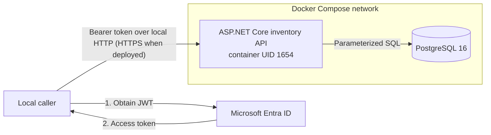
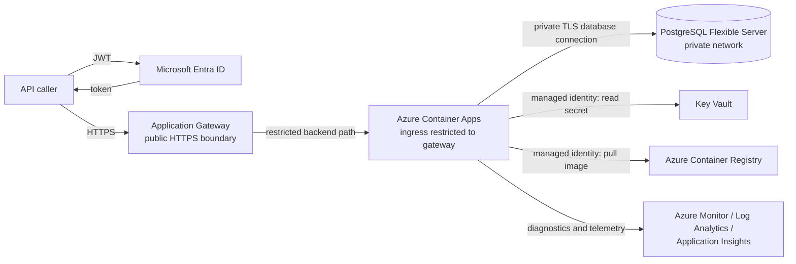

# Architecture and trust boundaries

## Current local slice

In the current local Compose setup, both the API and PostgreSQL are containerized. Compose publishes the API on loopback (`127.0.0.1:8080`) and the database on loopback (`127.0.0.1:5432`); the API connects to PostgreSQL over the Compose network. A local demo password is supplied only for development.

## Intended Azure shape (not deployed)

This is a target design, not an implementation diagram. The exact Container Apps environment/network mode, gateway integration, PostgreSQL private DNS, egress rules, and SKU selection must be validated in Bicep and against regional service support before deployment.

## Boundaries and data

- **Caller boundary:** only callers with a valid Entra-issued token, the configured API audience, and the required delegated scope or app role may use inventory routes. Health probes are intentionally anonymous and expose only health status.
- **Public edge (target):** Application Gateway terminates public TLS and forwards only to the API. Backend ingress should not be directly public. WAF and TLS policy selection remain deployment decisions.
- **Workload boundary:** the API is the only service that needs database and Key Vault access. It should use a dedicated managed identity and least-privilege role assignments; neither is configured in Azure yet.
- **Data boundary:** inventory records are stored in PostgreSQL. The database is local in development and must be private-only in the Azure target. Connection strings and tokens are sensitive; do not put them in source, images, logs, or checked-in parameter files.
- **Telemetry boundary:** application logs and diagnostics should flow to the selected Azure monitoring workspace. Redact credentials, tokens, customer data, and tenant-specific identifiers before retaining or publishing evidence.

## Failure behavior and operational targets

- Liveness reports whether the process can respond; it does not depend on PostgreSQL.
- Readiness probes PostgreSQL and returns HTTP 503 when the dependency is unavailable. The observed local smoke result was 503 with no local database running.
- Database unavailability prevents inventory operations. The API currently has no retry policy, circuit breaker, or measured recovery objective.
- No availability, latency, RTO, or RPO objective has been agreed or measured. Set these before the Azure deployment and label targets separately from observed results.
- Autoscaling, resource limits, backup policy, zone resiliency, alerts, and restore behavior are not configured or tested.
